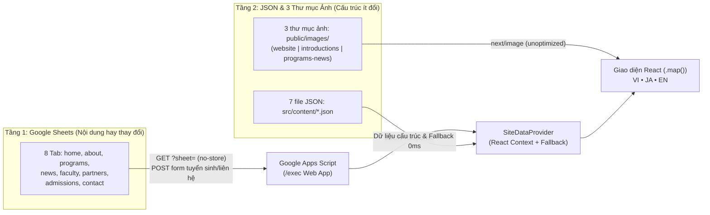
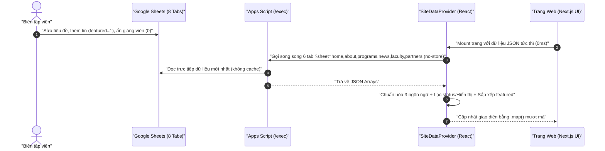

# TÀI LIỆU WORKFLOW VẬN HÀNH, QUẢN TRỊ DỮ LIỆU & KỊCH BẢN DEMO

**Dự án:** Website Cổng thông tin Học thuật & Trao đổi Du học sinh **Việt - Nhật** (Trường Đại học Mở TP.HCM — HCMCOU)  
**Mã dự án:** `web-viet-nhat-academic` (`Smart-Home-SH/demowebou` — nhánh `webvn`)  
**Đối tượng sử dụng:** Ban Giám đốc, Biên tập viên nội dung, Đội ngũ vận hành & Trình diễn Demo  
**Cập nhật lần cuối:** 23/11/2026  

---

## MỤC LỤC

1. [Tổng quan Kiến trúc 2 Tầng Dữ liệu (Google Sheets + JSON)](#1-tổng-quan-kiến-trúc-2-tầng-dữ-liệu-google-sheets--json)
2. [Chuẩn bị Môi trường & Vận hành Kỹ thuật](#2-chuẩn-bị-môi-trường--vận-hành-kỹ-thuật)
3. [Cấu trúc Dữ liệu Google Sheets (8 Tab — Không cần mở Apps Script)](#3-cấu-trúc-dữ-liệu-google-sheets-8-tab)
4. [Cấu trúc JSON & 3 Thư mục Ảnh (Không hard-code trong HTML)](#4-cấu-trúc-json--3-thư-mục-ảnh)
5. [Quy trình Kết nối: Nhập liệu $\rightarrow$ Apps Script $\rightarrow$ React `.map()`](#5-quy-trình-kết-nối-nhập-liệu--apps-script--react-map)
6. [Cơ chế Dự phòng (Fallback), Đa ngôn ngữ 3 thứ tiếng & Route bài mới không 404](#6-cơ-chế-dự-phòng-đa-ngôn-ngữ--route-bài-mới-không-404)
7. [Sổ tay Thao tác nhanh cho Biên tập viên](#7-sổ-tay-thao-tác-nhanh-cho-biên-tập-viên)
8. [Kịch bản Demo Trực tiếp (5 Bước trình diễn hoàn chỉnh)](#8-kịch-bản-demo-trực-tiếp-5-bước-trình-diễn-hoàn-chỉnh)

---

## 1. TỔNG QUAN KIẾN TRÚC 2 TẦNG DỮ LIỆU (GOOGLE SHEETS + JSON)

Website được xây dựng theo kiến trúc **Static Export (Next.js 16) + Serverless Headless CMS (Google Sheets)**, tách bạch hoàn toàn nội dung khỏi mã nguồn HTML/JSX:



### Lợi ích cốt lõi khi trình bày Demo:
- **Biên tập viên chỉ mở Google Sheet để sửa:** Không cần cài code, không cần mở lại Apps Script, không phải đợi cache — sửa xong bấm **F5** trên web là cập nhật ngay lập tức.
- **Không hard-code trong HTML/JSX:** Toàn bộ câu chữ cấu trúc, menu, FAQ, lộ trình, đối tác và đường dẫn ảnh nằm gọn trong `src/content/*.json` và được render bằng `.map()` trong React.
- **Nhanh & Chống sập 24/7:** Màn hình mở màn cổ điển Việt - Nhật (`ClassicalCurtain`, thuần GPU, chạy 1 lần mỗi phiên) + `LazyReveal` cuộn mượt; nếu Google Sheets mất mạng hoặc bảo trì, web lập tức lấy dữ liệu dự phòng từ JSON mà không bị trắng trang.

---

## 2. CHUẨN BỊ MÔI TRƯỜNG & VẬN HÀNH KỸ THUẬT

### 2.1. Yêu cầu môi trường
- **Node.js:** `v20.x` – `v24.x` LTS
- **Trình quản lý gói:** `pnpm 9.12.2` (khớp `package.json`)
- **Kiểm thử E2E:** Playwright (`@playwright/test`)

### 2.2. Lệnh thao tác chuẩn
```powershell
# 1. Di chuyển vào thư mục dự án
cd "D:\Học tập\Web_Viet_Nhat"

# 2. Kích hoạt pnpm & cài thư viện
corepack enable
corepack prepare pnpm@9.12.2 --activate
pnpm install --frozen-lockfile

# 3. Kiểm tra chuẩn mã nguồn (0 errors, 0 warnings)
pnpm lint

# 4. Đóng gói bản tĩnh (xuất ra thư mục out/ gồm 23 static routes)
pnpm build

# 5. Chạy kiểm thử tự động toàn bộ 8 kịch bản Playwright
npx playwright test

# 6. Chạy bản preview cục bộ để demo
npx --yes serve out -l 3000
```

---

## 3. CẤU TRÚC DỮ LIỆU GOOGLE SHEETS (8 TAB)

Google Sheet quản trị (`1v-WuSh5M3V1az6970Y8sP6OhOUoAeTYhHy6MS73zVRU`) gồm **6 tab đọc nội dung** (`doGet`) và **2 tab nhận biểu mẫu** (`doPost`):

> **Quy tắc đa ngôn ngữ thông minh:** Bạn **chỉ bắt buộc nhập Tiếng Việt**. Nếu bỏ trống cột Tiếng Nhật (`ja`) hoặc Tiếng Anh (`en`), website tự động hiển thị Tiếng Việt thay thế để không bao giờ bị khoảng trắng.

### Tab 1: `home` — Nội dung Trang chủ & Liên hệ nhanh
| Tên cột | Ý nghĩa | Ví dụ |
| :--- | :--- | :--- |
| **`key`** | Mã vị trí chữ trên giao diện | `badge`, `main_title`, `subtitle`, `btn_explore`, `btn_contact`, `card_title`, `card_subtitle`, `stat_students_count`, `stat_students`, `section_news_title`, `btn_view_all`, `btn_read_more`, `contact_phone`, `contact_email` |
| **`vi`** | Nội dung Tiếng Việt | `Trung Tâm Hợp Tác Học Thuật Việt - Nhật` |
| **`ja`** | Nội dung Tiếng Nhật *(tùy chọn)* | `日越学術協力センター` |
| **`en`** | Nội dung Tiếng Anh *(tùy chọn)* | `Vietnam - Japan Academic Center` |

### Tab 2: `about` — Trang Giới thiệu (`/about`)
| Tên cột | Ý nghĩa | Các mã chính (`Mã nội dung`) |
| :--- | :--- | :--- |
| **`Mã nội dung`** | Khóa định danh khối văn bản | `tieu_de_chinh`, `phu_de`, `mo_ta_chinh`, `su_menh_tieu_de`, `su_menh_mo_ta`, `tam_nhin_tieu_de`, `tam_nhin_mo_ta`, `lich_su_tieu_de`, `lich_su_1`, `lich_su_2` |
| **`Tiếng Việt`** | Đoạn văn Tiếng Việt | *"Trung Tâm Hợp Tác Học Thuật Việt - Nhật..."* |
| **`Tiếng Nhật`** | Đoạn văn Tiếng Nhật *(tùy chọn)* | *"日越学術協力センターは..."* |
| **`Tiếng Anh`** | Đoạn văn Tiếng Anh *(tùy chọn)* | *"The Vietnam - Japan Academic Center..."* |

### Tab 3: `programs` — Chương trình Trao đổi, Học bổng & Tiếng Nhật (`/programs`)
| Tên cột | Ý nghĩa | Quy tắc điền |
| :--- | :--- | :--- |
| **`slug`** | Đường dẫn định danh (không dấu) | VD: `exchange-program-tokyo`, `hoc-bong-osaka-2027` |
| **`category`** | Nhóm lọc theo tab | Điền 1 trong 3 giá trị: `exchange` (Trao đổi), `scholarship` (Học bổng), `japanese` (Tiếng Nhật) |
| **`title`** / `titleJa` / `titleEn` | Tên chương trình (VI / JA / EN) | Chỉ bắt buộc `title` |
| **`description`** / `descriptionJa` / `descriptionEn` | Mô tả ngắn | Hiển thị trên thẻ chương trình |
| **`overview`** / `requirement` | Tổng quan & Điều kiện chi tiết | Hiển thị bên trong trang chi tiết `/programs/...` |
| **`duration`** | Thời lượng | VD: `1 - 2 học kỳ`, `4 - 6 tháng` |
| **`image`** | Ảnh đại diện | Đường dẫn `/images/programs-news/...` hoặc link ảnh `https://...` |
| **`features`** | Danh sách quyền lợi nổi bật | Ngăn cách bằng dấu phẩy `,` hoặc dấu gạch đứng `\|` |
| **`status`** / `order` | Trạng thái & thứ tự | `TRUE`/`1` để hiện, `FALSE`/`0` để tạm ẩn |

### Tab 4: `news` — Tin tức, Hội thảo & Học bổng (`/news`)
| Tên cột | Ý nghĩa | Quy tắc điền |
| :--- | :--- | :--- |
| **`slug`** | Đuôi URL bài viết (không dấu) | VD: `tuyen-sinh-trao-doi-sinh-vien-nhat-ban-2027` |
| **`category`** | Phân loại | `announcement`, `event`, hoặc `scholarship` |
| **`date`** | Ngày đăng | `YYYY-MM-DD` (VD: `2026-11-23`) |
| **`featured`** | Ghim tin tiêu điểm lên đầu | Điền **`1`** hoặc **`TRUE`** để gắn nhãn `★ Tiêu điểm` & đẩy lên đầu danh sách; `0` hoặc `FALSE` cho tin thường |
| **`title`** / `titleJa` / `titleEn` | Tiêu đề bài viết | Chỉ bắt buộc `title` |
| **`excerpt`** / `excerptJa` / `excerptEn` | Tóm tắt ngắn | Hiển thị ngoài thẻ danh sách |
| **`content`** *(hoặc `content VI` / `content EN`)* | Nội dung chi tiết bài viết | Hỗ trợ xuống đoạn bằng `Alt + Enter` trong ô Google Sheet |
| **`image`** / **`status`** | Ảnh bìa & trạng thái hiển thị | `TRUE`/`1` để hiện, `FALSE`/`0` để ẩn |

### Tab 5: `faculty` — Hội đồng Cố vấn & Giảng viên (`/faculty`)
| Tên cột | Ý nghĩa | Quy tắc điền |
| :--- | :--- | :--- |
| **`ID`** | Số thứ tự sắp xếp | `1`, `2`, `3`... |
| **`Tên`** *(+ `Tên JA`, `Tên EN`)* | Họ tên & học hàm/học vị | *PGS.TS. Nguyễn Văn An*, *GS.TS. Tanaka Kenji* |
| **`Chức vụ VI` / `JA` / `EN`** | Chức danh công tác | *Giám đốc Trung tâm*... |
| **`Chuyên môn VI` / `EN`** | Lĩnh vực phụ trách | *Hợp tác học thuật quốc tế Việt - Nhật*... |
| **`Mô tả VI` / `JA` / `EN`** | Tiểu sử tóm tắt | Đoạn giới thiệu thành tựu giảng viên |
| **`Đơn vị VI` / `EN`** | Đơn vị công tác | *Giảng viên cơ hữu HCMCOU*... |
| **`Hiển thị`** | Bật / tắt hiển thị trên web | Điền **`1`** hoặc **`TRUE`** để hiện; **`0`** hoặc **`FALSE`** để ẩn |

### Tab 6: `partners` — Đại học Đối tác Nhật Bản
| Tên cột | Ý nghĩa | Ví dụ |
| :--- | :--- | :--- |
| **`name`** | Tên trường đại học đối tác | `The University of Tokyo`, `Kyoto University` |
| **`country`** / `countryJa` / `countryEn` | Thành phố / Quốc gia | `🇯🇵 Tokyo, Nhật Bản` |
| **`status`** / `order` | Trạng thái & thứ tự | `TRUE`/`1` để hiện |

### Tab 7 & 8: `admissions` & `contact` — Tự động lưu Form từ Website
- Khi sinh viên nộp đơn tại `/admissions` $\rightarrow$ Apps Script tự ghi vào tab **`admissions`** kèm thời gian và trạng thái `Chờ xử lý`.
- Khi phụ huynh/sinh viên gửi câu hỏi tại `/contact` $\rightarrow$ Apps Script tự ghi vào tab **`contact`** kèm trạng thái `Mới tiếp nhận`.

---

## 4. CẤU TRÚC JSON & 3 THƯ MỤC ẢNH

Toàn bộ nội dung cấu trúc ít thay đổi và đường dẫn ảnh được tách ra khỏi JSX vào `src/content/` và `public/images/`:

| Thành phần | Vị trí | Nội dung quản lý |
| :--- | :--- | :--- |
| **JSON Cấu hình chung** | `src/content/site.json` | Thương hiệu `VNJ`, `navItems`, danh sách ngôn ngữ (`VI`, `日`, `EN`), `footerPrograms`, Google Map URL |
| **JSON Trang chủ** | `src/content/home.json` | Khẩu hiệu & ảnh Hero, 3 trụ cột Hero, 3 thẻ `features`, 4 chỉ số `stats`, danh sách `partners` mặc định |
| **JSON Nội dung các trang** | `src/content/pages.json` | Khối highlights `/about`, bộ lọc/mục tiêu `/programs`, badge tiêu điểm `/news`, lộ trình 4 bước & FAQ `/admissions`, form labels `/contact`, trang `404` |
| **JSON Dự phòng & Từ điển** | `src/content/i18n.json`, `programs.json`, `news.json`, `faculty.json` | Từ điển 3 ngôn ngữ & dữ liệu dự phòng khi Google Sheets offline |
| **Ảnh Website (Thư mục 1)** | `public/images/website/` | `hero-emblem.svg`, `feature-exchange.svg`, `feature-scholarship.svg`, `feature-japanese.svg` |
| **Ảnh Giới thiệu & Đội ngũ (Thư mục 2)** | `public/images/introductions/` | `about-heritage.svg`, `faculty-avatar.svg` |
| **Ảnh Chương trình & Tin tức (Thư mục 3)** | `public/images/programs-news/` | `program-exchange.svg`, `program-scholarship.svg`, `program-japanese.svg`, `news-announcement.svg`, `news-event.svg`, `news-scholarship.svg` |

---

## 5. QUY TRÌNH KẾT NỐI: NHẬP LIỆU $\rightarrow$ APPS SCRIPT $\rightarrow$ REACT `.map()`



---

## 6. CƠ CHẾ DỰ PHÒNG, ĐA NGÔN NGỮ & ROUTE BÀI MỚI KHÔNG 404

1. **Cơ chế Dự phòng 2 tầng (Zero-Lag & Zero-Crash):**
   - Tầng HTML tĩnh hiển thị ngay bằng dữ liệu JSON trong `src/content/*.json` (`0ms` chờ mạng).
   - Khi API Google Sheets phản hồi (timeout bảo vệ `8000ms`), `SiteDataProvider` ghi đè dữ liệu mới lên giao diện; nếu mất mạng hoặc một tab chưa được tạo trên Sheet (`{ error: ... }`), hệ thống bỏ qua an toàn và giữ nguyên dữ liệu JSON dự phòng.
2. **Đa ngôn ngữ 3 thứ tiếng (`VI` / `JA` / `EN`):**
   - Nút chuyển đổi trên Header lưu trạng thái vào `localStorage`, đồng bộ toàn bộ menu, nhãn, khẩu hiệu mở màn (`ClassicalCurtain`) và dữ liệu Google Sheet.
3. **Thêm bài mới / chương trình mới trên Google Sheet KHÔNG bị lỗi 404:**
   - Các bài có sẵn lúc build dùng route tĩnh `/news/[slug]` và `/programs/[slug]`.
   - Khi biên tập viên **thêm một dòng bài viết hoặc chương trình hoàn toàn mới trên Google Sheet**, `SiteDataProvider` tự động điều hướng qua route dự phòng `/news/detail/?slug=<slug-moi>` và `/programs/detail/?slug=<slug-moi>` — người dùng bấm **"Xem thêm / Xem chi tiết"** mở đọc được ngay **mà không cần rebuild lại code**.

---

## 7. SỔ TAY THAO TÁC NHANH CHO BIÊN TẬP VIÊN

| Nhu cầu chỉnh sửa | Tab trên Google Sheet | Cách thao tác |
| :--- | :--- | :--- |
| **Đổi tiêu đề, phụ đề, nút bấm trang chủ** | `home` | Tìm đúng `key` (VD: `main_title`), sửa cột `vi`, `ja`, `en` (có thể bỏ trống `ja`/`en`) |
| **Cập nhật bài giới thiệu, sứ mệnh, tầm nhìn** | `about` | Tìm `Mã nội dung` (VD: `mo_ta_chinh`, `su_menh_mo_ta`), sửa trực tiếp rồi F5 web |
| **Thêm chương trình trao đổi / học bổng mới** | `programs` | Thêm dòng cuối bảng: nhập `slug`, `category` (`exchange`/`scholarship`/`japanese`), `title`, `features` (ngăn cách `,` hoặc `\|`), `status = 1` |
| **Đăng tin tức mới & ghim lên đầu trang** | `news` | Thêm dòng cuối bảng: nhập `slug`, `title`, `excerpt`, `content`, đặt `featured = 1`, `status = 1` |
| **Tạm ẩn giảng viên hoặc thêm giảng viên mới** | `faculty` | Sửa cột `Hiển thị` thành `0` (ẩn) hoặc `1` (hiện) |
| **Thêm trường ĐH đối tác tại Nhật Bản** | `partners` | Thêm dòng tên trường, khu vực và `status = 1` |
| **Xem danh sách sinh viên đăng ký / liên hệ** | `admissions` / `contact` | Mở 2 tab cuối để theo dõi hồ sơ nộp từ website |

---

## 8. KỊCH BẢN DEMO TRỰC TIẾP (5 BƯỚC TRÌNH DIỄN HOÀN CHỈNH)

Khi đi demo trước khách hàng hoặc hội đồng, bạn thực hiện đúng **5 bước sau (~3–4 phút)** để thể hiện trọn vẹn toàn bộ điểm mạnh của hệ thống:

1. **Bước 1 — Trình diễn Trải nghiệm Mở màn & Cuộn mượt (`0:00 – 0:45`):**
   - Mở tab ẩn danh truy cập vào link web (`http://localhost:3000` hoặc domain deploy).
   - Giới thiệu **Màn mở màn cổ điển Việt - Nhật** (Hoa Sen & Hoa Anh Đào + ấn triện đỏ son `日越`, chạy 1 lần mỗi phiên, hỗ trợ nút Bỏ qua).
   - Cuộn từ từ xuống trang chủ để thấy các section tự động lazy-load & hiện lên mượt mà (`LazyReveal`), không giật lag.
2. **Bước 2 — Trình diễn Đa ngôn ngữ 3 thứ tiếng (`0:45 – 1:15`):**
   - Bấm lần lượt **`🇻🇳 VI` ➔ `🇯🇵 日` ➔ `🇬🇧 EN`** trên thanh Header để thấy toàn bộ tiêu đề, menu, chương trình, tin tức và đội ngũ tự động chuyển đổi tức thì.
3. **Bước 3 — Demo Chỉnh sửa & Đăng bài mới trực tiếp trên Google Sheet (`1:15 – 2:30`):**
   - Mở song song 2 cửa sổ: bên trái là **Google Sheet**, bên phải là **Website**.
   - Vào tab `home`, đổi thử câu `subtitle` hoặc `main_title` ➔ qua website nhấn **F5**: chữ cập nhật ngay mà **không hề đụng tới code hay Apps Script**.
   - Vào tab `news`, thêm 1 dòng bài viết mới với `featured = 1` ➔ qua trang `/news` nhấn **F5**: bài mới hiện ngay ở đầu với nhãn **`★ Tiêu điểm`**, bấm **"Xem thêm"** để mở đọc trang chi tiết (chứng minh cơ chế `/news/detail/?slug=...` không bị 404).
4. **Bước 4 — Demo Nộp hồ sơ Tuyển sinh & Lưu tự động về Sheet (`2:30 – 3:15`):**
   - Vào trang `/admissions`, điền thử 1 hồ sơ sinh viên (Họ tên, Email, SĐT, chọn chương trình, lời nhắn) ➔ bấm **Gửi hồ sơ đăng ký**.
   - Chuyển sang tab **`admissions`** trên Google Sheet để người xem thấy dòng hồ sơ vừa nộp tự động xuất hiện kèm dấu thời gian chính xác.
5. **Bước 5 — Tổng kết Kiến trúc Bền vững (`3:15 – 3:45`):**
   - Giải thích nhanh: toàn bộ nội dung tĩnh & 3 thư mục ảnh đều tách ra file JSON (`src/content/*.json`, `public/images/`), không hard-code trong JSX; và dù Google Sheets có bảo trì thì web vẫn chạy ổn định nhờ dữ liệu dự phòng JSON.
